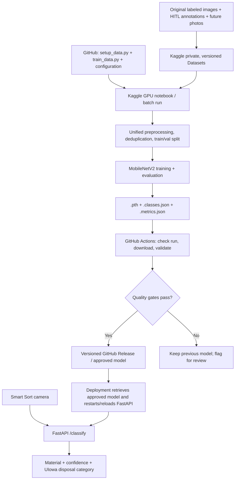

# Smart Sort: A Free, Cloud-Based ML Training and Model-Release Pipeline

**Team concept proposal | November 3, 2026**  
**Status:** Proposed architecture—not implemented or deployed.  
**Project:** Smart Sort, University of Iowa waste-material recognition using MobileNetV2 and FastAPI.

> **The idea in one sentence:** Keep our labeled image datasets in Kaggle, train Smart Sort on Kaggle's free cloud GPUs while our laptops are off, let GitHub Actions retrieve and check each newly trained model, and publish approved model files for our existing FastAPI classifier to use.

## 1. Why propose this?

We have successfully consolidated **5,504 deduplicated images from two data sources into 11 material categories**, but preparation and model training currently run on a team member's computer, with large files stored on a USB drive. That creates practical bottlenecks:

- The laptop has to remain powered on during long preparation/training runs.
- The Humans in the Loop (HITL) source archive is approximately **10–11 GB**, so local disk space and temporary copies are an issue.
- New datasets have to be physically transferred or stored on that computer before retraining.
- We manually obtain the trained checkpoint and set up the running API to use it.
- We need a repeatable way for teammates to compare models before deploying a new one.

**The cloud proposal separates the job of *training* from the job of *classifying*.** Kaggle would train a model occasionally. FastAPI would classify camera photos continuously with a downloaded, approved checkpoint—without contacting Kaggle for each prediction.

## 2. Where Smart Sort stands today (measured project results)

These are figures from our successful local `setup_data.py` run, **not Kaggle benchmarks or predicted training accuracy**.

| Current fact | Value |
|---|---:|
| Original six-class dataset before deduplication | 2,527 images |
| Original dataset after deduplication | 2,524 images |
| Combined dataset after processing original images + HITL | **5,504 images** |
| Total modeled material classes | **11** |
| Net gain in usable images versus the original prepared set | **2,980 images (+118%)** |
| Source datasets combined | 2 |
| HITL annotations read during combined import | 3,201 |
| Objects recognized from HITL annotations before subsequent filtering | 3,075 |
| Near-duplicate images reported | 84 |
| Conflicting near-duplicates reported | 11 |
| Conflicting exact duplicates reported | 3 |
| Material annotations not mapped | 131 |
| Current training strategy | MobileNetV2, PyTorch, train/validation split, best-checkpoint selection |

### Class distribution

| Material | Prepared images | Share of 5,504 |
|---|---:|---:|
| Plastic | 1,771 | 32.2% |
| Paper | 1,312 | 23.8% |
| Metal | 825 | 15.0% |
| Glass | 759 | 13.8% |
| Cardboard | 403 | 7.3% |
| Tetra Pak | 171 | 3.1% |
| Trash | 137 | 2.5% |
| Textile | 59 | 1.1% |
| Polystyrene | 37 | 0.7% |
| Cellulose acetate | 21 | 0.4% |
| Rubber | 9 | 0.2% |
| **Total** | **5,504** | **100% (rounded)** |

**Caution:** Having 11 classes does not mean all 11 will classify reliably. In particular, rubber (9 images), cellulose acetate (21), polystyrene (37), and textile (59) are data-limited. Our historical six-class model scored **74% on an earlier 100-image benchmark**, but that result is not a validated score for the new 11-class checkpoint, and the old benchmark's routing labels have limitations. **No accuracy improvement is claimed until the new model is independently evaluated.**

**Licensing caveat:** HITL's Recycling Dataset is published as **CC0**; our recovered original TrashNet images are **MIT-licensed**. Using both is possible with appropriate compliance, but the combined dataset is **not CC0-only**, which differs from our original licensing preference. The team should settle this before publishing data or claiming all imagery is public domain. [1]

## 3. Proposed architecture



### Important distinction: Kaggle training is **not** the live classification service

**Training path (occasional):** Datasets → Kaggle GPU → model files → GitHub Actions → approved model release.

**Classification path (every scan):** Camera → `POST /classify` in `app.py` → locally loaded model → material/confidence/disposal result.

The classification path does **not** require the training images or a Kaggle connection. It requires:

- `app.py`, the MobileNetV2 architecture and preprocessing logic;
- `smart_sort_mobilenetv2_combined.pth` (learned model weights);
- `smart_sort_mobilenetv2_combined.classes.json` (the exact ordered material classes);
- Python/runtime dependencies (PyTorch, torchvision, Pillow, FastAPI, etc.).

The `.classes.json` is essential: output index 0/1/2/etc. must map to the correct material. Updating the repository or a GitHub Release **does not by itself update an already-running FastAPI process**. Deployment must download the approved files and restart or explicitly reload the model.

## 4. Verified platform capacity and limits

**Figures verified against provider documentation on November 3, 2026.** Free services are subject to quotas, eligibility, capacity, and policy changes; actual limits should be checked before implementation.

| Resource or rule | Published limit / capability | Meaning for Smart Sort |
|---|---|---|
| **Kaggle Dataset maximum** | **200 GB per dataset** [2] | Our 10–11 GB HITL archive is well below the nominal per-dataset limit. |
| **Kaggle private-dataset allowance** | **200 GB total private datasets** [2] | Enough nominal persistent storage for current images and reasonable growth, subject to actual extracted sizes. |
| **Kaggle dataset upload structure** | **50 top-level files maximum** [2] | Organize images in subfolders or an archive, rather than uploading thousands of files at the root. |
| **Kaggle GPU time** | **30 hours/week, sometimes higher** [3] | A free GPU budget for periodic retraining; not unlimited or guaranteed on demand. |
| **Kaggle GPU options documented** | **1 NVIDIA Tesla P100**, or **2 Tesla T4 GPUs** [4] | PyTorch training can use a remote GPU, instead of laptop CPU or locally configured CUDA. |
| **Kaggle CPU/GPU run duration** | **12 hours per session** [4] | Training must finish within a run or implement checkpoints/resumption. |
| **Kaggle saved notebook output** | **20 GB in `/kaggle/working`** [4] | Save checkpoints, metrics and only necessary outputs; avoid saving extra copies of raw images. |
| **Kaggle additional scratch disk** | Available, but **not persisted after session** [4] | Temporary processing space may be used, but the pipeline cannot rely on it for permanent datasets. |
| **Kaggle remote execution** | **Save & Run All** executes in a separate cloud session [4] | After the job is submitted, the laptop/browser need not stay open; runs can still end due to quotas, errors or limits. |
| **Kaggle scheduled runs** | Daily/weekly/monthly or when a dataset updates; dataset-update runs **at most once/day** [4] | Option to automate retraining without constantly manually launching it. |
| **GitHub standard Linux runner disk** | **14 GB SSD** [5] | Too tight to comfortably unpack and train on the raw 10–11 GB archive; use GitHub as orchestrator, not training host. |
| **GitHub-hosted job duration** | **6 hours maximum per job** [6] | Don't have one Actions job block indefinitely waiting on a long Kaggle run; use polling in short jobs or a follow-up scheduled workflow. |
| **GitHub Free Actions** | Standard runners are free for **public** repos; private repos have an included usage allowance [7] | Keep orchestration lightweight; set spending limits if using a private repo. |
| **GitHub ordinary Git file size** | **100 MB hard limit per Git object** [8] | Committing a checkpoint only works if it stays below this limit; repeated binary commits bloat Git history. |
| **GitHub Release assets** | Each asset **under 2 GiB**; up to **1,000 assets per release** [9] | Better location for versioned `.pth`, `.classes.json`, and metrics than repeated binary commits. |

**Do not confuse the storage limits:** **200 GB of Kaggle private Datasets** is not the same as **20 GB of saved notebook output**. A large dataset can be attached as an input, but preprocessing should avoid duplicating the entire archive into the saved output directory. Kaggle documentation says uploaded archives may be unpacked for convenient dataset access, so verify the *extracted* footprint, not only the compressed 10–11 GB archive. [2][4]

**Free-cost assessment:** This approach can plausibly operate at **$0 in cloud compute/storage charges while within Kaggle's free quotas and GitHub's included allowances**. This is a *conditional budget*, not a promise of unlimited free GPUs, guaranteed availability, or free internet hosting of FastAPI. Any deployment server or upgraded service could have separate costs.

## 5. What improves over our laptop-based process?

| Today | Proposed cloud workflow |
|---|---|
| Images live on a local USB drive; a team member maintains them. | Persistent private, versioned Kaggle datasets are shared with authorized teammates. |
| Laptop must stay running during training. | Start a Kaggle batch run, then turn off laptop; remote run continues independently within limits. |
| Local disk space is constrained, especially by the HITL archive. | Raw sources remain in Kaggle storage; processing uses cloud compute and planned temporary storage. |
| Manual steps to incorporate future datasets. | Upload a new dataset version; rerun centralized setup with all sources. |
| Manual checkpoint handoff. | GitHub Actions can fetch the completed model via the Kaggle CLI. |
| Risk of deploying an untested model. | Automated compatibility and metric checks; preserve last approved model and rollback. |
| Retraining is difficult to reproduce precisely across teammates' machines. | Log dataset versions, seeds, training parameters, package versions, and metrics per run. |

**Expected benefits, not measured results:** better convenience, easier collaboration, fewer local hardware constraints, and potentially faster GPU training. **Training time, accuracy gain, speedup, and reliability must be benchmarked.** Cloud GPU access does not automatically produce higher accuracy from the same data.

## 6. How the proposed automation could work

### Step A — Store data once, then version it

1. Create *private* Kaggle datasets for the original labeled images and HITL material-annotated images.
2. Retain HITL `ds0/img/<image-name>` and `ds0/ann/<image-name>.json` together, preserving exact filenames and mixed image extensions.
3. Keep source license information and provenance alongside each dataset.
4. When adding photographs, upload a new dataset version; do not discard the older sources.
5. Grant collaborators access to the private Kaggle datasets explicitly. Kaggle notebook sharing does **not** automatically grant dataset access. [4]

### Step B — Make setup safe for Kaggle (a small code change is required)

Our current two-mode `setup_data.py` assumes **writable local folders** and may **move** new source folders into `raw_data/sources`. Kaggle datasets are mounted as **read-only inputs** (typically `/kaggle/input/...`). Therefore, the existing script cannot simply be copied to Kaggle and expected to move those mounts.

A cloud-compatible mode should:

- Read **all** registered sources directly from the attached Kaggle datasets, without moving/deleting them.
- Use the existing material-tag parser and cross-source exact/near-duplicate checks.
- Keep images from one original photograph in the same split to avoid leakage.
- Build the temporary unified `raw_data/train` and `raw_data/val` under writable cloud storage, e.g. `/kaggle/working/raw_data`, or stream directly into training if disk capacity demands it.
- Save counts, source/version IDs, licenses, excluded records and class order as metadata.
- Delete only temporary cloud copies after successful training; **never delete the persistent original sources**.

This preserves our preferred rule of **one logical centralized training dataset**, while allowing permanent originals to live safely in Kaggle's versioned dataset storage.

### Step C — Run PyTorch training remotely

- Attach the source datasets to a GPU-enabled Kaggle notebook or Python script.
- Run cloud-compatible setup/deduplication, then `train_data.py` on the **whole combined dataset**, not only newly added images.
- When starting a fresh experiment, initialize as configured (ImageNet backbone or from scratch). If continuing from an old Smart Sort checkpoint, explicitly select that checkpoint and record it in the run metadata.
- Save the best validated model and produce:

```text
smart_sort_mobilenetv2_combined.pth
smart_sort_mobilenetv2_combined.classes.json
smart_sort_mobilenetv2_combined.metrics.json
```

- Use **Save Version → Save & Run All**, or trigger a notebook/script via Kaggle's authenticated CLI. The run is cloud-side, so a teammate's laptop may be powered off afterward. [4][10]

### Step D — GitHub Actions collects and evaluates results

GitHub Actions would use the official Kaggle CLI/API with credentials held in **GitHub Actions Secrets**, not committed in code. The CLI supports checking notebook status and downloading output. [10][11]

Conceptual CLI steps (not a ready-to-run workflow):

```bash
# Wait/check until the expected notebook version has completed successfully.
kaggle kernels status USERNAME/smartsort-training

# Download THAT approved run/version's outputs, not blindly any unverified run.
kaggle kernels output USERNAME/smartsort-training -p ./model-candidate
```

Next, the workflow would check:

1. The Kaggle run exited successfully and all three expected files exist.
2. The checkpoint is loadable by the current MobileNetV2 architecture.
3. The number and ordered names of output classes match `.classes.json`.
4. Recorded training data and licenses are acceptable to the team.
5. Metrics meet team-agreed gates; independent testing is not worse than the approved baseline.
6. The candidate is tied to an immutable dataset version, run ID and code revision.

If approved, Actions publishes a **versioned GitHub Release** and designates it the current approved model. An optional small model could also be committed directly to Git, but Releases are preferable for frequent binary updates. Failed checks should leave the existing approved model untouched.

### Step E — Deploy to FastAPI

The Smart Sort runtime downloads or receives the newly approved `.pth` **and matching** `.classes.json` as a pair, verifies them, and restarts/reloads `app.py`. The camera keeps using the same API contract:

```json
{
  "classification": "recycling",
  "confidence": 0.92,
  "material": "metal",
  "latency_ms": 42.0
}
```

*Illustrative response only, not an actual measurement.*

Kaggle is **not** contacted per scan. If the inference service runs on our laptop, that laptop must still be powered on to serve requests. To have the **classifier** accessible while every team laptop is off, FastAPI must run on an independent device (e.g., the Smart Sort hardware) or a separately hosted server. **Free Kaggle training does not include free 24/7 FastAPI hosting.**

## 7. Quality controls specific to Smart Sort

A cloud workflow must protect model quality—not just produce a new `.pth` file.

- **Check each material separately.** There are only 9 rubber images and 21 cellulose acetate images. A high overall accuracy could conceal near-zero performance on rare categories.
- **Create a held-out, independently labeled test set** that never enters training or model selection. Report overall accuracy, macro-F1, per-class recall, confusion matrix and confidence distribution.
- **Prevent data leakage:** group crops from the same source photo, deduplicate across sources and train/validation/test splits, and watch for near-identical photos from different exports.
- **Keep model/material definitions separate from disposal rules.** Identifying an object as `plastic` does not prove it is an accepted recyclable plastic item at the University of Iowa. Material-only fallback routing needs explicit caveats.
- **Keep a stable evaluation baseline.** The historical 74% score is from a different six-class benchmark and cannot by itself validate the new eleven-class model.
- **Require approval before production.** Suggested acceptance targets are **≥85% independently tested accuracy** and **no more than 5% of predictions below 50% confidence**—the team's goals, **not achieved results**. Also require acceptable per-class scores, with special scrutiny for the smallest classes.
- **Keep a rollback model.** If a new release fails checks or causes regression, leave the current model running.

## 8. Licensing, privacy and security

- **HITL Recycling Dataset:** Publisher identifies it as CC0. [1]
- **Original TrashNet:** The recovered six-class image source has been treated as MIT-licensed, not CC0; confirm exact provenance and relevant license conditions before sharing or publishing the combined data.
- **Private datasets remain private by default only if configured that way.** Explicitly share with teammates who need access; avoid publishing third-party photographs or student images without approval.
- **Keep credentials secret.** Store Kaggle credentials in GitHub Actions Secrets; grant GitHub's `GITHUB_TOKEN` only the permissions needed to publish an approved release. [11][12]
- **Record provenance.** Track license, dataset version, date, source counts, hashes and exclusions alongside every model release.
- **Review institutional expectations.** Check any University of Iowa rules about storing collected photographs or institutional data on third-party cloud services before upload.

## 9. Why not Qdrant?

**Qdrant is a vector database**, designed for storing/searching embeddings (for example, finding training photos visually similar to a misclassified object). It is **not a GPU training environment** and does not replace Kaggle's PyTorch compute. We do **not** need Qdrant for the proposed pipeline.

If Smart Sort eventually needs *visual similarity search* or hard-example retrieval, Qdrant could become an optional addition. It would not store or train the original image dataset as a substitute for Kaggle.

## 10. Suggested rollout plan (not yet implemented)

| Phase | Small milestone | Definition of success |
|---|---|---|
| **1. Confirm permissions and ownership** | Agree on dataset rights, privacy, Kaggle ownership and shared credentials. | Team has approved use of each image source. |
| **2. Prove one Kaggle job** | Upload the datasets privately; adapt setup for read-only inputs; run 1 training cycle on Kaggle. | All expected classes recognized; model + metrics downloadable; no laptop required after launch. |
| **3. Validate quality** | Compare cloud model to current approved model using a fixed, independent evaluation set. | No class-order mismatch or unreviewed accuracy regression. |
| **4. Add GitHub Actions** | Automatically retrieve a completed Kaggle run and publish validated outputs to a GitHub Release. | Repeatable, authenticated release with audit trail and rollback. |
| **5. Connect deployment** | Have FastAPI deployment install an approved model pair and reload safely. | `/classify` still returns the established fields, and rollback works. |
| **6. Add optional scheduling** | Automatically rerun after a Kaggle dataset version update. | New data flows through training without a team laptop staying on. |

### Proposed team responsibilities

- **ML/data owner:** Dataset versions, annotation mappings, duplicate checks, train/test integrity and rare-class data collection.
- **Automation owner:** Kaggle batch jobs, GitHub Actions orchestration, credentials and model release logic.
- **API/deployment owner:** Runtime model loading, deployment/restart, class-order tests and rollback.
- **Evaluation/review owner:** Independent test set, pass/fail criteria and University of Iowa routing review.

## 11. Team decision: what we gain, and what it does *not* solve

**We gain:** a feasible **free-tier cloud training pipeline**, less dependence on one person's laptop/USB drive, centralized dataset versions, repeatable retraining, and controlled model updates.

**We do not automatically gain:** higher recognition accuracy, unlimited GPU time, permanent free FastAPI hosting, or seamless deployment without some initial engineering. A Kaggle quota can be exhausted; a run can fail; some materials need many more examples.

**Recommended first step:** Run **one reproducible, manually triggered Kaggle training experiment** with the existing 5,504-image/11-class dataset. Measure its total runtime, compute and storage footprint, checkpoint size, per-class accuracy and output compatibility. Once that succeeds, add GitHub Actions and automated releases.

---

## References — official sources unless noted

Accessed/checked November 3, 2026. Provider quotas can change.

1. Humans in the Loop, *Recycling Dataset* (CC0 claim): https://humansintheloop.org/resources/datasets/recycling-dataset/
2. Kaggle, *Datasets Documentation* (200 GB per dataset, 200 GB private allowance, upload structure): https://www.kaggle.com/docs/datasets
3. Kaggle, *Efficient GPU Usage Tips* (roughly 30 GPU hours/week, subject to quota): https://www.kaggle.com/docs/efficient-gpu-usage
4. Kaggle, *Notebooks Documentation* (12-hour CPU/GPU sessions, 20 GB saved output, P100/T4, Save & Run All, scheduled runs): https://www.kaggle.com/docs/notebooks
5. GitHub, *Choosing the runner for a job* (standard runner 14 GB SSD): https://docs.github.com/en/actions/how-tos/write-workflows/choose-where-workflows-run/choose-the-runner-for-a-job
6. GitHub, *Actions limits* (six-hour maximum per GitHub-hosted job): https://docs.github.com/en/actions/reference/limits
7. GitHub, *Actions billing* (public/private repository free-usage rules): https://docs.github.com/en/billing/concepts/product-billing/github-actions
8. GitHub, *Repository limits* (ordinary Git object 100 MB hard limit): https://docs.github.com/en/repositories/creating-and-managing-repositories/repository-limits
9. GitHub, *About releases* (release-asset limits): https://docs.github.com/en/repositories/releasing-projects-on-github/about-releases
10. Kaggle, *Official CLI: Kernels* (`push`, `status`, `output`): https://github.com/Kaggle/kaggle-cli/blob/main/docs/kernels.md
11. GitHub, *Secrets reference*: https://docs.github.com/en/actions/reference/security/secrets
12. GitHub, *GITHUB_TOKEN*: https://docs.github.com/en/actions/concepts/security/github_token

**Source of Smart Sort image counts:** Team's successful local setup run on November 3, 2026 (`setup_data.py` output shared in the project conversation). Counts are project measurements, not externally published datasets statistics.
